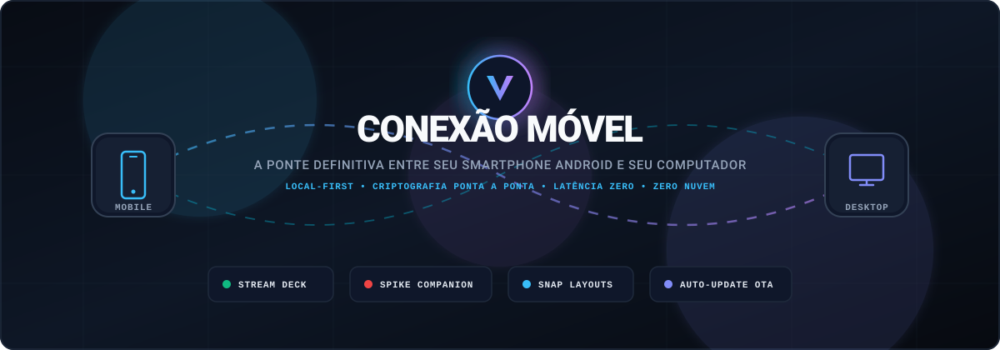
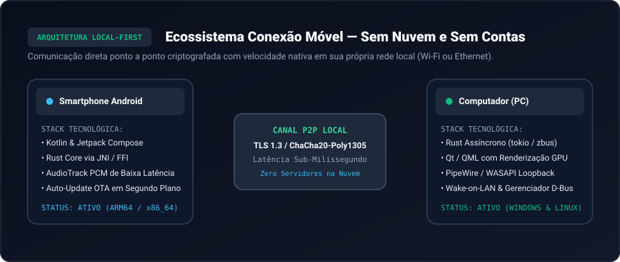
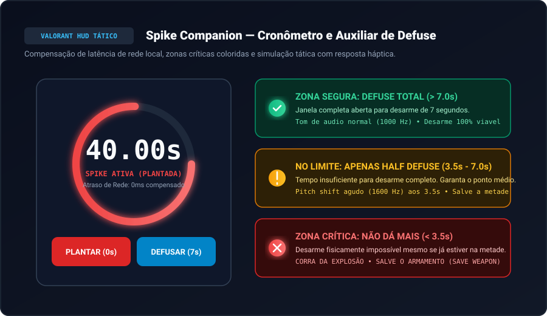
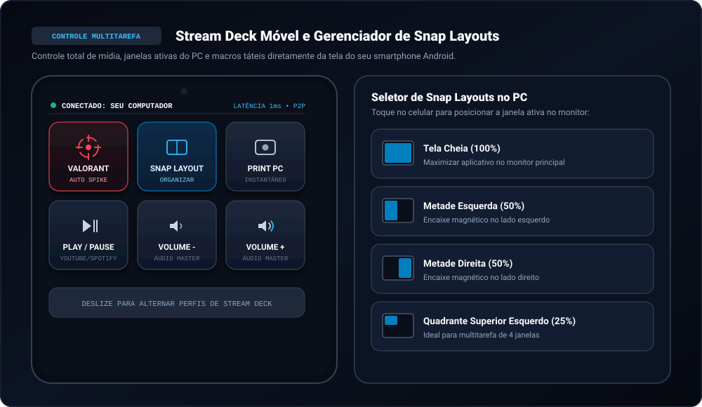

<div align="center">



<br>

<p align="center">
  <a href="https://github.com/vincentaistudios/conexao-movel/releases/tag/v0.1.8"></a>
  <a href="https://github.com/vincentaistudios/conexao-movel/releases/tag/v0.1.8"></a>
  
  
  
  
  <a href="LICENSE"></a>
</p>

**A ponte definitiva entre o seu smartphone Android e o seu computador com máxima privacidade, latência zero e sem dependência de nuvem.**

Notificações em tempo real, controle de mídia, espelhamento de tela em alta taxa de quadros, transferência instantânea de arquivos, Wake-on-LAN, atalhos de **Snap Layouts** e o revolucionário **Spike Companion HUD para Valorant**.

[Instalação Rápida](#guia-rapido-de-instalacao) • [Recursos Principais](#recursos-principais) • [Spike Companion HUD](#destaque-gamer-spike-companion-para-valorant) • [Novidades v0.1.8](#novidades-da-versao-v018) • [Arquitetura](#arquitetura-e-seguranca)

</div>

---

## Apresentação

O **Conexão Móvel** nasceu para eliminar atritos entre dispositivos móveis e estações de trabalho de alta performance. Diferente de soluções comerciais convencionais que exigem criação de contas obrigatórias, tráfego por servidores de terceiros ou assinaturas pagas, o Conexão Móvel é concebido sob a filosofia **Local-First**:

- **Privacidade Absoluta**: Seus dados, notificações, toques e arquivos trafegam exclusivamente dentro da sua rede local (Wi-Fi ou cabo Ethernet), protegidos por criptografia ponta a ponta (TLS 1.3 e ChaCha20-Poly1305).
- **Latência Praticamente Nula**: Comunicação direta entre o aplicativo em Kotlin no celular e o núcleo nativo em Rust no computador, garantindo respostas sub-milissegundo para jogos e produtividade.
- **Atualização Automática Silenciosa**: Tanto no celular quanto no PC, o aplicativo verifica novidades em segundo plano e instala atualizações de forma transparente, sem exigir downloads manuais frequentes.

---

## Recursos Principais

<div align="center">
  
</div>

### 1. Stream Deck Tático Mobile
Transforme o seu smartphone em um centro de comando profissional para o computador:
- Grade personalizada de atalhos táteis com feedback háptico.
- Controle individual de volume de aplicativos em execução no Windows ou Linux.
- Alternância de dispositivos de saída de áudio (fone de ouvido, caixas de som e monitores).
- Botões de macro para captura de tela instantânea, bloqueio de sessão e atalhos de desenvolvedor.

### 2. Espelhamento de Tela e Snap Layouts no PC
- Espelhe o celular em janelas dedicadas com renderização acelerada por GPU.
- **Seletor de Snap Layouts**: Toque no celular para posicionar qualquer janela do computador instantaneamente em **Tela Cheia (100%)**, **Metade Esquerda (50%)**, **Metade Direita (50%)** ou em **Quadrantes**, acelerando o fluxo multitarefa.

### 3. Gestão Inteligente de Notificações
- Notificações do celular sincronizadas com a área de trabalho do PC com ações rápidas de resposta.
- **Filtro Anti-Flood**: Tratamento rigoroso contra repetições desnecessárias de alertas de sistema e pressão de memória, mantendo o ambiente limpo e silencioso.

### 4. Controle de Energia e Wake-on-LAN
- Ligue o computador remotamente a partir de qualquer cômodo da casa utilizando pacotes mágicos Wake-on-LAN.
- Temporizadores de sono, agendamentos automáticos de desligamento e botões de reinicialização e suspensão.

### 5. Transferência Direta de Arquivos e Fotos
- Compartilhe fotos, vídeos, instaladores e documentos arrastando arquivos entre as telas, sem perda de qualidade e com taxa de transferência máxima permitida pelo roteador local.

---

## Destaque Gamer: Spike Companion para Valorant

<div align="center">
  
</div>

Desenvolvido especialmente para jogadores competitivos de **Valorant**, o Spike Companion HUD é um assistente tático de tela cheia acessível diretamente no Stream Deck do celular:

### Como Funciona a Tomada de Decisão Tática
- **Contagem Regressiva de 40 Segundos**: Acionamento em 0ms com compensação dinâmica de atraso de rede local.
- **Zona Segura (Tempo restante superior a 7.0s)**:
  - Indicador visual em **Verde Esmeralda**.
  - Janela completa de desarme aberta (o defuse integral dura 7.0s).
- **No Limite / Half Defuse (Tempo restante entre 7.0s e 3.5s)**:
  - Indicador visual em **Amarelo Âmbar**.
  - Não há tempo suficiente para o defuse total, mas o ponto médio (3.5s) ainda pode ser garantido.
  - Síntese de áudio PCM com **pitch shift agudo** aos 3.5s indicando a passagem exata da metade.
- **Zona Crítica / Não Dá Mais (Tempo restante inferior a 3.5s)**:
  - Indicador visual em **Vermelho Carmesim** com sinalização de impacto.
  - O desarme é fisicamente impossível mesmo se o jogador já estiver na metade.
  - Alerta enfático: **Corra da explosão e salve o armamento (Save Weapon)**.
- **Resposta Háptica Progressiva (Tactile Heartbeat)**: O motor de vibração do smartphone acelera a frequência conforme o cronômetro se aproxima da detonação, permitindo que o jogador sinta o tempo sem precisar desviar o olhar da mira.

---

## Demonstração do Stream Deck e Snap Layouts

<div align="center">
  
</div>

---

## Novidades da Versão v0.1.8

A versão `v0.1.8` consolida as seguintes melhorias:

1. **Spike Companion HUD Integrado**: Módulo completo no Stream Deck com cálculo em milissegundos, áudio em dois tons e matriz visual de 3 cores.
2. **Controle Remoto de Snap Layouts**: Menu interativo para redimensionar e encaixar janelas ativas no Windows com 1 toque no celular.
3. **Filtro Anti-Flood de Notificações**: Supressão proativa de mensagens repetitivas de pressão de memória e risco de travamento em dispositivos móveis.
4. **Infraestrutura Oficial no GitHub e Auto-Update Silencioso**:
   - Criação do repositório oficial da organização: [github.com/vincentaistudios/conexao-movel](https://github.com/vincentaistudios/conexao-movel).
   - Feed OTA (`channels/stable.json`) para atualizações autônomas no PC e no celular sem necessidade de redistribuição manual de APKs.
5. **Atualização da Versão Nativa do Windows**: Suporte aprimorado no Windows 10 e 11 com links diretos de download.

---

## Guia Rápido de Instalação

### No Celular (Android 10 ou superior)
1. Acesse a [Release Oficial v0.1.8](https://github.com/vincentaistudios/conexao-movel/releases/tag/v0.1.8).
2. Baixe o pacote **`ConexaoMovel-android.apk`**.
3. Instale o APK no smartphone (habilite a permissão de instalação de fontes desconhecidas caso solicitado).
4. Uma vez instalado, o aplicativo passará a receber todas as atualizações futuras automaticamente em segundo plano.

### No Computador (Windows 10 / 11)
1. Baixe o instalador oficial **`ConexaoMovel-Windows-setup.exe`** da [Release v0.1.8](https://github.com/vincentaistudios/conexao-movel/releases/tag/v0.1.8).
2. Execute o instalador e conclua a instalação em poucos segundos.
3. O serviço de inicialização e o atalho no menu iniciar serão configurados automaticamente.

### No Computador (Linux x86_64)
1. Baixe o executável **`ConexaoMovel-linux-x86_64`**.
2. Conceda permissão de execução e inicie o aplicativo:
```bash
chmod +x ConexaoMovel-linux-x86_64
./ConexaoMovel-linux-x86_64
```

### Emparelhamento em 1 Clique
1. Abra o aplicativo no computador e no celular conectados à mesma rede Wi-Fi ou cabo de rede.
2. O computador será detectado automaticamente via mDNS.
3. Caso prefira, confirme o pareamento seguro digitando o código de 6 dígitos exibido na tela do computador.

---

## Arquitetura e Segurança

| Componente | Plataforma | Tecnologia Central | Papel no Sistema |
| :--- | :--- | :--- | :--- |
| **Núcleo de Sistema** | Windows / Linux / Android | Rust (`tokio`, `quinn`) | Criptografia, barramento de eventos, RPC e I/O de alta performance |
| **Interface Móvel** | Android | Kotlin &amp; Jetpack Compose | HUD tático, atalhos do Stream Deck, sintetizador PCM e haptics |
| **Interface Desktop** | Windows / Linux | Qt / QML (C++ e Rust Bridge) | Painéis de vidro fosco, controle de janelas e renderização GPU |
| **Áudio e Mídia** | Sistema Operacional | PipeWire &amp; WASAPI Loopback | Captura e transmissão de áudio em tempo real sem latência |
| **Canal de Rede** | P2P Local | TLS 1.3 / ChaCha20-Poly1305 | Troca de dados com sigilo estrito e sem servidores intermediários |
| **Esteira de Auto-Update** | Cross-Platform | GitHub Releases &amp; Channels Feed | Checagem contínua via requisições condicionais HTTP e instalação autônoma |

---

## Licença e Desenvolvimento

O **Conexão Móvel** é desenvolvido e mantido pela equipe da **Vincent AI Studios** sob licença de código aberto:
- Os aplicativos e interfaces gráficas são disponibilizados sob a licença **GPL-3.0**.
- O núcleo de sincronização e bibliotecas fundamentais são disponibilizados sob a licença **MPL-2.0**.

Contribuições, relatos de melhorias e sugestões são bem-vindos diretamente na aba de Issues do repositório oficial:
[github.com/vincentaistudios/conexao-movel/issues](https://github.com/vincentaistudios/conexao-movel/issues)
