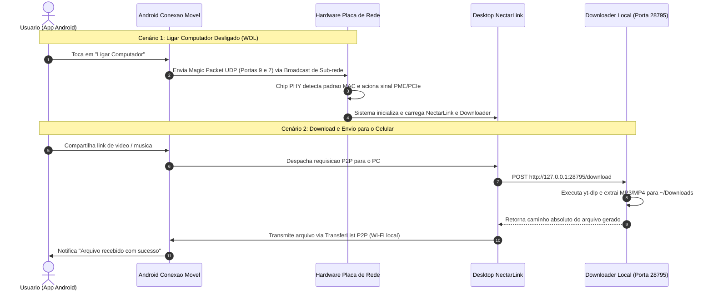

# Especificacao Arquitetural: Instalador Windows, Downloader de Midias e Wake-on-LAN

Este documento define os requisitos de arquitetura, contratos de empacotamento, operacoes de Registro do Windows e fluxo de servicos para o instalador desktop do Conexao Movel (desenvolvido em C# .NET).

---

## 1. Visao Geral da Arquitetura

O ecossistema do Conexao Movel no Windows integra tres subsistemas fundamentais:

1. **Cliente Desktop Principal (`nectarlink-desktop.exe`)**: Aplicativo nativo em Rust/Qt que gerencia sincronizacao, interface grafica, audio, notificacoes e comandos remotos.
2. **Servico de Downloads de Midias (`downloader_server.py` na porta 28795)**: Daemon local desacoplado que opera via HTTP REST em `127.0.0.1:28795`, acionando `yt-dlp` e `ffmpeg` de forma assincrona e nao-bloqueante.
3. **Subsistema de Wake-on-LAN (WOL)**: Infraestrutura de baixo nivel no Windows que mantem as controladoras de rede fisicas prontas para receber pacotes magicos (Magic Packets UDP) enviados pelo smartphone Android pareado.

---

## 2. Layout de Arquivos e Componentes de Instalacao

O instalador C# .NET deve criar e organizar a estrutura de diretorios sob `%ProgramFiles%\Nectarlink` (ou `%LOCALAPPDATA%\Nectarlink` em instalacoes por usuario sem elevacao global):

```
C:\Program Files\Nectarlink\
├── nectarlink-desktop.exe       [Executavel principal da interface]
├── nectarlink_vcam.dll          [Modulo DirectShow / Media Foundation]
├── bin\
│   ├── yt-dlp.exe               [Motor de extracao de midias web]
│   ├── ffmpeg.exe               [Conversao e multiplexacao de audio/video]
│   └── ffprobe.exe              [Inspecao rapida de fluxos multimidia]
├── downloader\
│   ├── downloader_server.py     [Servidor HTTP REST assincrono (porta 28795)]
│   ├── downloader_service.py    [Orquestrador de subprocessos yt-dlp/ffmpeg]
│   └── google_bridge_routes.py  [Roteamento de servicos de nuvem]
└── runtime\
    ├── python.exe               [Interpretador Python embedded 3.11 x64]
    ├── pythonw.exe              [Interpretador sem console/janela]
    └── python311.dll            [Bibliotecas de tempo de execucao]
```

### 2.1. Execucao Silenciosa do Servico de Downloads

O daemon de download deve ser executado exclusivamente sem janela de terminal (modo invisivel):
- Utilizar `pythonw.exe` apontando para `downloader\downloader_server.py`.
- No C# .NET, iniciar via `ProcessStartInfo` com:
  * `CreateNoWindow = true`
  * `UseShellExecute = false`
  * `WindowStyle = ProcessWindowStyle.Hidden`

---

## 3. Servico de Downloads na Porta 28795

### 3.1. Politica de Seguranca Zero-Trust
O servidor HTTP vincula-se estritamente ao endereco `127.0.0.1` na porta `28795`. Qualquer requisicao contendo cabecalho `Origin` externo (que nao seja `http://127.0.0.1` ou `http://localhost`) e sumariamente rejeitada com codigo HTTP 403. Nenhuma porta precisa ser aberta no Firewall do Windows para este servico.

### 3.2. Endpoints e Contratos de Dados

| Metodo | Rota | Funcao |
| :--- | :--- | :--- |
| `GET` | `/health` | Checagem de integridade do daemon e versao dos componentes. |
| `POST` | `/inspect` | Extracao rapida de titulo, duracao e miniatura (`{ "url": "..." }`). |
| `POST` | `/download` | Inicia download assincrono (`format`: audio/video/both, `destination`: pc/phone/both). |
| `GET` | `/status?task_id=...` | Progresso em tempo real, porcentagem e velocidade. |
| `POST` | `/cancel` | Interrompe processo filho de forma segura. |
| `GET` | `/history` | Lista dos ultimos downloads salvos em `%USERPROFILE%\Downloads`. |
| `GET` | `/clipboard` | Leitura sanitizada da area de transferencia para colagem com 1 clique. |

---

## 4. Configuracao Mandatoria de Wake-on-LAN (WOL)

Para que o smartphone Android consiga ligar o computador remotamente a qualquer momento, o instalador do Windows DEVE aplicar duas configuracoes criticas no sistema operacional.

### 4.1. Desativacao do Fast Startup (Inicializacao Rapida)

#### Diagnostico do Problema
O Windows 10 e 11 vem com o recurso "Fast Startup" (Hiberboot) ativado por padrao. Quando ativado, o desligamento do sistema nao e um desligamento real (estado ACPI S5), mas uma hibernacao do nucleo do kernel (estado S4 hibrido).
Na maioria dos chipsets e drivers de rede modernos (Realtek, Intel, Killer), o modo S4 hibrido desliga completamente o barramento PCIe e desenergiza o chip PHY da placa de rede, impedindo a escuta de Magic Packets quando o PC e desligado.

#### Acoes Exigidas do Instalador
1. **Comando de Sistema**: Executar de forma elevada:
   ```cmd
   powercfg.exe -h off
   ```
2. **Registro do Windows**: Garantir o valor zero na chave Hiberboot:
   - Caminho: `HKLM\SYSTEM\CurrentControlSet\Control\Session Manager\Power`
   - Nome: `HiberbootEnabled`
   - Tipo: `REG_DWORD`
   - Valor: `0`

### 4.2. Habilitacao de Wake-on-LAN nos Adaptadores de Rede Fisicos

O instalador deve iterar sobre os adaptadores de rede fisicos instalados e habilitar o recebimento de Magic Packets na chave de classe de rede do Windows:
- Chave Base: `HKLM\SYSTEM\CurrentControlSet\Control\Class\{4d36e972-e325-11ce-bfc1-08002be10318}`
- Cada subchave numerada (`0000`, `0001`, `0002`...) representa uma interface de rede.

#### Filtro de Seguranca: Apenas Placas Fisicas
Para nao corromper adaptadores virtuais de maquinas virtuais ou redes privadas (Hyper-V, WSL, Docker, VMware, OpenVPN, Tailscale), o instalador deve aplicar os seguintes criterios:
1. `Characteristics`: O bit `0x04` (`NCF_PHYSICAL`) DEVE estar presente, e o bit `0x01` (`NCF_VIRTUAL`) NAO deve estar presente.
2. `DeviceInstanceID`: Nao deve iniciar com `ROOT\`, `SWD\` ou `UMB\`.
3. `DriverDesc` / `NetCfgInstanceId`: Ignorar descricoes contendo palavras virtuais (`vethernet`, `virtual`, `loopback`, `tap-`, `wintun`, `bluetooth`).

#### Valores de Registro a Aplicar nas Placas Fisicas:
1. `*WakeOnMagicPacket`:
   - Tipo: `REG_SZ` (ou `REG_DWORD`)
   - Valor: `"1"` (ou `1`)
2. `WakeOnMagicPacket`:
   - Tipo: `REG_SZ` (ou `REG_DWORD`)
   - Valor: `"1"` (ou `1`)
3. `PnPCapabilities`:
   - Tipo: `REG_DWORD`
   - Operacao: Limpar o bit `0x10` (`value = value & ~0x10`). O bit `0x10` corresponde a opcao "Desativar despertar por este dispositivo". Ao zera-lo, o Windows marca a opcao "Permitir que este dispositivo acorde o computador".
4. `*WakeOnPattern`:
   - Tipo: `REG_SZ`
   - Valor: `"0"` (Evita que ruidos de transmissao ou pings acidentais acordem o PC; apenas o Magic Packet acordara a maquina).

---

## 5. Implementacao de Referencia em C# .NET

Abaixo esta a rotina sugerida para inclusao no projeto do instalador C#:

```csharp
using System;
using System.Diagnostics;
using Microsoft.Win32;

namespace ConexaoMovel.Installer
{
    public static class SystemConfigurator
    {
        public static void ConfigureFastStartupAndWol()
        {
            DisableFastStartup();
            EnableWolOnPhysicalAdapters();
        }

        private static void DisableFastStartup()
        {
            try
            {
                // 1. Executa powercfg -h off
                var psi = new ProcessStartInfo
                {
                    FileName = "powercfg.exe",
                    Arguments = "-h off",
                    CreateNoWindow = true,
                    UseShellExecute = false
                };
                using var proc = Process.Start(psi);
                proc?.WaitForExit(5000);

                // 2. Garante HiberbootEnabled = 0 no Registro
                using var powerKey = Registry.LocalMachine.OpenSubKey(
                    @"SYSTEM\CurrentControlSet\Control\Session Manager\Power", true);
                powerKey?.SetValue("HiberbootEnabled", 0, RegistryValueKind.DWord);
            }
            catch (Exception ex)
            {
                Console.WriteLine($"Erro ao desativar Fast Startup: {ex.Message}");
            }
        }

        private static void EnableWolOnPhysicalAdapters()
        {
            const string netClassPath =
                @"SYSTEM\CurrentControlSet\Control\Class\{4d36e972-e325-11ce-bfc1-08002be10318}";

            using var baseKey = Registry.LocalMachine.OpenSubKey(netClassPath, true);
            if (baseKey == null) return;

            foreach (var subKeyName in baseKey.GetSubKeyNames())
            {
                if (subKeyName.Length != 4 || !int.TryParse(subKeyName, out _))
                    continue;

                using var adapterKey = baseKey.OpenSubKey(subKeyName, true);
                if (adapterKey == null) continue;

                var characteristics = adapterKey.GetValue("Characteristics") as int?;
                var deviceId = adapterKey.GetValue("DeviceInstanceID") as string ?? "";
                var desc = adapterKey.GetValue("DriverDesc") as string ?? "";

                // Verifica se e hardware fisico
                if (characteristics.HasValue)
                {
                    bool isVirtual = (characteristics.Value & 0x01) != 0;
                    bool isPhysical = (characteristics.Value & 0x04) != 0;
                    if (isVirtual || !isPhysical) continue;
                }

                if (deviceId.StartsWith("ROOT\\", StringComparison.OrdinalIgnoreCase) ||
                    deviceId.StartsWith("SWD\\", StringComparison.OrdinalIgnoreCase) ||
                    desc.IndexOf("virtual", StringComparison.OrdinalIgnoreCase) >= 0)
                {
                    continue;
                }

                // Aplica parametros de Wake-on-LAN
                adapterKey.SetValue("*WakeOnMagicPacket", "1", RegistryValueKind.String);
                adapterKey.SetValue("WakeOnMagicPacket", "1", RegistryValueKind.String);
                adapterKey.SetValue("*WakeOnPattern", "0", RegistryValueKind.String);

                var pnp = adapterKey.GetValue("PnPCapabilities") as int? ?? 0;
                int updatedPnp = pnp & ~0x10; // Limpa bit 0x10 (habilita wake)
                adapterKey.SetValue("PnPCapabilities", updatedPnp, RegistryValueKind.DWord);
            }
        }
    }
}
```

---

## 6. Integracao com o Cliente Desktop e Android



---

## 7. Criterios de Homologacao e Aceite

1. **Persistencia de Chaves de Registro**:
   - `HiberbootEnabled` deve permanecer com valor `0`.
   - Adaptadores Ethernet e Wi-Fi fisicos devem exibir `*WakeOnMagicPacket = 1` e `PnPCapabilities` sem o bit `0x10`.
2. **Leitura pelo Cliente Desktop**:
   - O modulo `desktop/app/src/win/wol.rs` deve retornar `support = WakeSupport::Enabled` e refletir `wake_state = "enabled"` nas propriedades de interface QML.
3. **Disponibilidade do Downloader**:
   - Uma chamada `GET http://127.0.0.1:28795/health` deve responder com status `ok` em menos de 100ms.
4. **Resiliencia de Rede**:
   - Placas virtuais (WSL/Docker/Hyper-V) devem permanecer intactas, sem alteracao em suas configuracoes de rede.
